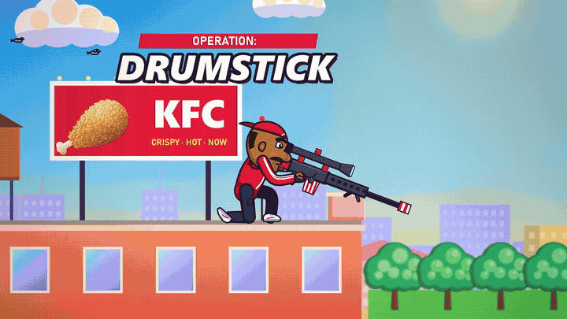
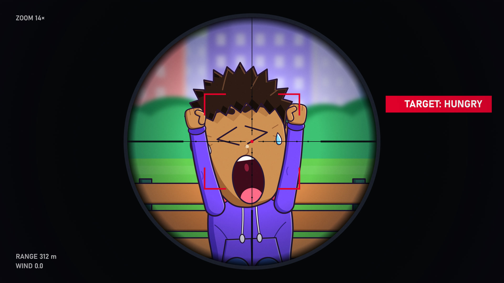
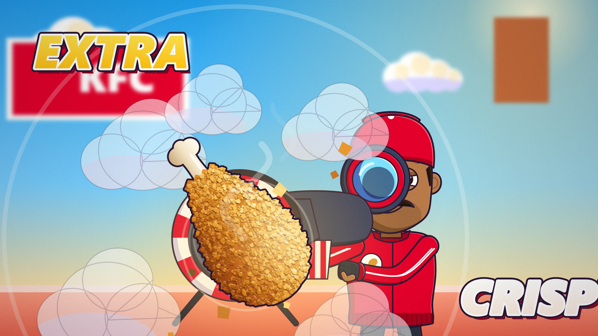
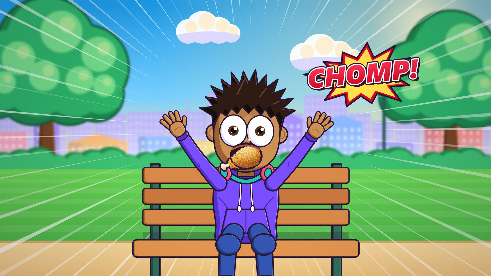
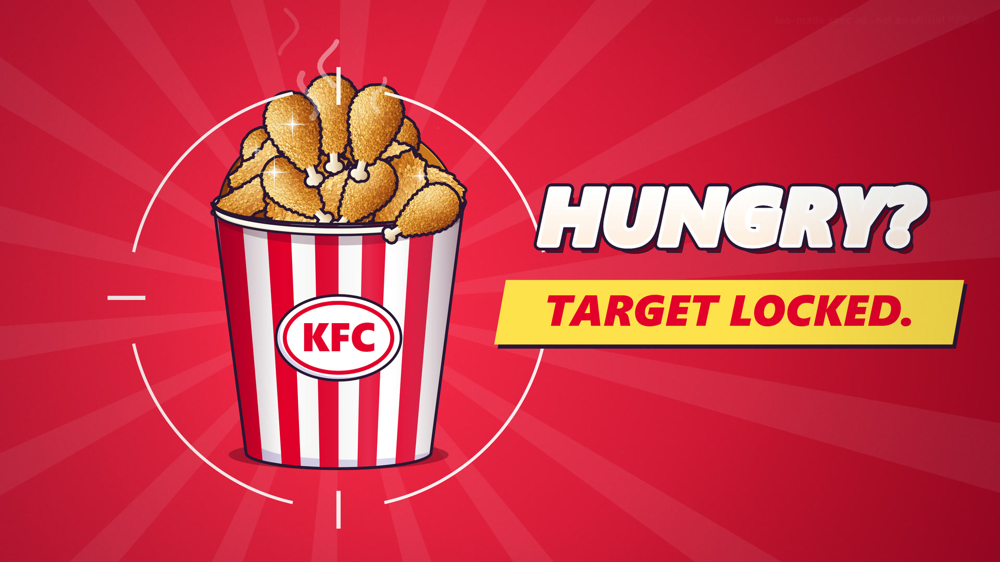

# KFC Sniper — 30s Animated Promo

A deterministic 30-second HTML5 Canvas 2D animated promo film crafted with custom 2D cel rigging, stylized comic action hits, dynamic camera choreography, and fully synchronized 48 kHz stereo sound design.

<div align="center">
  <a href="https://raisulsohan.github.io/KFC-Sniper/">
    
  </a>
  <p><em>Click the banner above to watch the full 60 fps interactive animation live in your browser.</em></p>
</div>

---

## 🌐 Live Demo

Watch the interactive 60 fps animation with full sound controls directly in your browser:  
👉 **[https://raisulsohan.github.io/KFC-Sniper/](https://raisulsohan.github.io/KFC-Sniper/)**

---

## 📸 Sneak Peek / Key Moments

<table>
  <tr>
    <td width="50%">
      
      <p align="center"><b>01 · The Gear-up & Scope</b></p>
    </td>
    <td width="50%">
      
      <p align="center"><b>02 · The BANG & Extra Crispy Burst</b></p>
    </td>
  </tr>
  <tr>
    <td width="50%">
      
      <p align="center"><b>03 · Direct Hit — CHOMP!</b></p>
    </td>
    <td width="50%">
      
      <p align="center"><b>04 · Reticle & Target Locked</b></p>
    </td>
  </tr>
</table>

---

## 🎬 Overview

- **Duration:** Exactly 30.000 seconds (1,800 frames @ 60 fps CFR)
- **Engine:** Deterministic synchronous Canvas 2D render engine (`window.__film.seek(t)`)
- **Aspect Ratios:**
  - **16:9** Widescreen (`1920×1080` native, `3840×2160` 4K @ 2× scale)
  - **4:5** Vertical Social (`1080×1350` native, `2160×2700` @ 2× scale)
- **Audio Mix:** 48 kHz stereo audio mix synchronized with sub-millisecond precision.

---

## 🚀 Running Locally

Open with any local HTTP server:

```bash
# Python
python -m http.server 8000

# or Node / npx
npx serve .
```

Then visit:
- **Default (16:9):** `http://localhost:8000/` (a portrait screen, such as a phone, opens the 4:5 cut automatically)
- **4:5 Social Version:** `http://localhost:8000/?ar=4x5`
- **Deterministic 4K Render Mode:** `http://localhost:8000/?capture&scale=2`

---

## ⌨️ Player Keyboard Shortcuts

| Key | Action |
| :--- | :--- |
| <kbd>Space</kbd> / <kbd>K</kbd> | Play / Pause |
| <kbd>←</kbd> / <kbd>→</kbd> or <kbd>,</kbd> / <kbd>.</kbd> | Step backward / forward 1 frame |
| <kbd>Shift</kbd> + <kbd>←</kbd> / <kbd>→</kbd> | Jump backward / forward 1 second |
| <kbd>Home</kbd> / <kbd>End</kbd> | Jump to start / end |
| <kbd>M</kbd> | Mute / Unmute audio |
| <kbd>L</kbd> | Toggle Loop playback |
| <kbd>F</kbd> | Toggle Fullscreen |

---

## 🛠️ Tech Stack & Architecture

- **Renderer:** Pure HTML5 Canvas 2D (zero build dependencies, deterministic synchronous draws).
- **Animation Rigging:** Inverse kinematics (IK), procedural spring physics, vector strokes, soft-light film grain, and camera transitions.
- **Audio Synchronization:** Master clock synchronized with Web Audio / HTML5 audio.

---

## 👤 Author

Crafted by **Raisul Sohan**  
GitHub: [@raisulsohan](https://github.com/raisulsohan)
